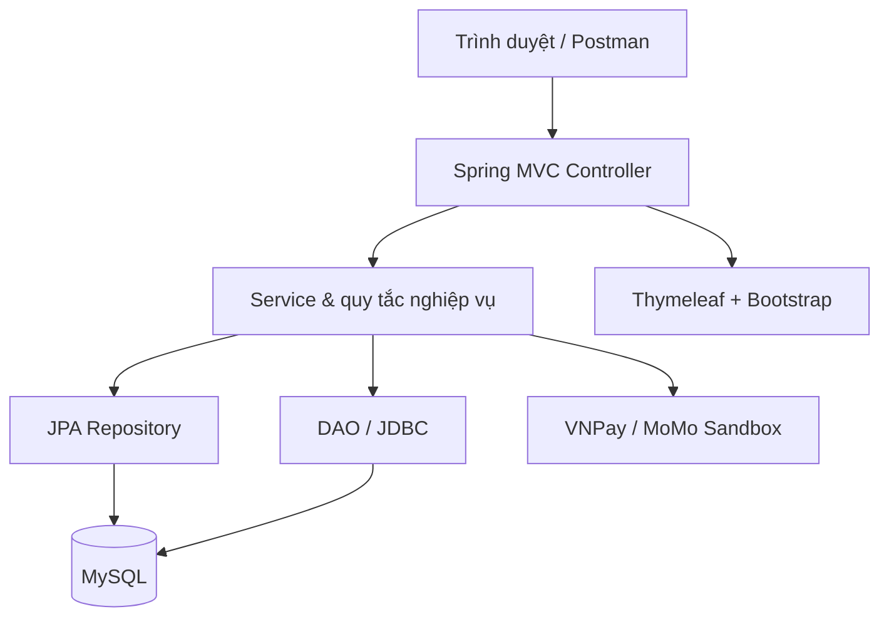
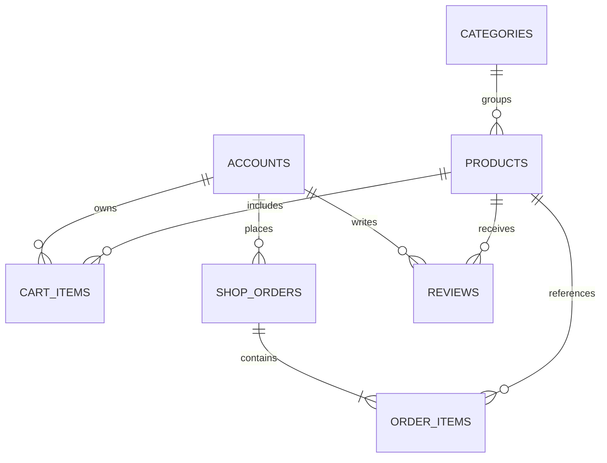

# Phân tích và thiết kế website bán laptop

## 1. Phạm vi

Hệ thống quản lý bán laptop trực tuyến từ tra cứu đến đặt hàng, thanh toán, giao hàng và đánh giá. Hai vai trò chính: CUSTOMER và ADMIN. Khách chưa đăng nhập chỉ được xem danh mục/sản phẩm/đánh giá, đăng ký và đăng nhập. Cổng thanh toán là actor bên ngoài.

## 2. Ma trận chức năng → mã nguồn

| Nhóm chức năng | Thiết kế / triển khai | Ghi chú |
|---|---|---|
| Đăng ký, đăng nhập, phân quyền | AccountService, SecurityConfig | BCrypt, khách không truyền role |
| Hồ sơ và lịch sử | StoreController, AccountService, OrderService.owned | Kiểm tra chủ đơn trong service |
| Tìm và lọc | CatalogService.search | JPA Specification, phân trang 12, whitelist sort |
| Cấu hình | Product, product.html | CPU, RAM, SSD, GPU, màn hình |
| Giỏ hàng | CartService, CartItemRepository | DB lưu theo tài khoản; max 20/sản phẩm |
| Đặt hàng, giảm giá | OrderServiceImpl.checkout | Transaction, khóa tồn, snapshot giá |
| COD | OrderServiceImpl.transition | Đã giao đồng thời xác nhận thu tiền |
| VNPay/MoMo sandbox | PaymentGateway, PaymentService, PaymentController | Cần merchant và public HTTPS IPN |
| Đánh giá sau mua | ReviewService | Phải có đơn DELIVERED; một lần/người/sản phẩm |
| Danh mục | CategoryDao/JdbcCategoryDao | JDBC CRUD thực tế có UI |
| Sản phẩm/ảnh | CatalogService, ImageStorage | Validation, khóa và version chống ghi đè |
| Kho | Product.stock | Số lượng khả dụng; giữ hàng khi tạo đơn |
| Xử lý đơn | OrderService.transition | Không cho nhảy trạng thái |
| Báo cáo | ReportDao + admin/dashboard.html | Ngày/tháng/năm, top 10 theo số lượng |

## 3. Kiến trúc phân lớp

Client–server mô tả giao tiếp trình duyệt–server, không bắt buộc SPA. Monolith vẫn tách Presentation / Business / Data Access. ORM được dùng cho miền giao dịch, JDBC dùng cho danh mục và thống kê.

## 4. Mô hình dữ liệu

| Bảng | Thuộc tính chính | Ràng buộc |
|---|---|---|
| accounts | email, password_hash, full_name, role | Email duy nhất |
| categories | name | Tên duy nhất |
| products | category_id, brand, purpose, cấu hình, price, stock, active, version | Giá/tồn không âm; FK danh mục |
| cart_items | account_id, product_id, quantity | Cặp tài khoản/sản phẩm duy nhất |
| shop_orders | account_id, trạng thái đơn/tiền, tổng tiền, địa chỉ, checkout_token, payment_ref, timestamps | Token và payment_ref duy nhất |
| order_items | order_id, product_id, product_name, unit_price, quantity | Lưu snapshot tên/giá |
| reviews | account_id, product_id, rating, content | Cặp người/sản phẩm duy nhất; 1–5 sao |

Các FK được định nghĩa trong SQL MySQL. Entity dùng khóa ngoại dạng ID thay vì quan hệ JPA lazy để demo dễ theo dõi và không serialize graph. H2 test tự tạo schema từ entity nên không chứng minh toàn bộ hành vi FK/MySQL; cần chạy checklist MySQL riêng.

Tiền dùng `long` / `BIGINT`, đơn vị đồng VND; không dùng float/double. Giá đơn là tổng đơn giá đã snapshot × số lượng, trừ giảm giá. Giảm 5% dùng số nguyên, chặn tối đa 500.000 đồng. Kiểm tra overflow bằng Math.addExact/Math.multiplyExact ở tạo đơn.

## 5. Trạng thái và quy tắc

```mermaid
stateDiagram-v2
  [*] --> NEW
  NEW --> PREPARING: Admin duyệt; online phải PAID
  PREPARING --> SHIPPING: Bắt đầu giao
  SHIPPING --> DELIVERED: Giao xong / thu COD
  NEW --> CANCELLED: Khách hủy COD / online thất bại
  NEW --> EXPIRED: Online chờ quá hạn
  DELIVERED --> [*]
  CANCELLED --> [*]
  EXPIRED --> [*]
```

Trạng thái tiền độc lập với giao hàng:

| Giá trị | Ý nghĩa |
|---|---|
| PENDING | Chưa thu COD hoặc đang chờ online |
| PAID | Online xác nhận thành công hoặc COD thu khi giao |
| FAILED | Cổng thông báo thất bại |
| CANCELLED | COD bị hủy trước duyệt |
| EXPIRED | Online hết thời gian giữ hàng |
| REVIEW_REQUIRED | Cổng báo thành công sau khi đơn đã đóng; cần xử lý thủ công |

Giữ hàng: trừ stock ngay trong transaction tạo đơn. Khi hủy/thất bại/hết hạn, hoàn stock đúng một lần trong transaction. Khi PAID không trừ lần hai. Các sản phẩm khóa theo thứ tự ID tăng dần để giảm deadlock. Với thanh toán đến muộn, không tự khôi phục đơn/giao hàng vì tồn kho có thể đã bán cho người khác.

Chống lặp: checkout token duy nhất + khóa tài khoản; IPN khóa đơn và từ chối áp dụng kết quả hai lần. Việc mở cổng thanh toán diễn ra sau transaction tạo đơn, không xóa đơn nếu cổng chậm/mất kết nối.

## 6. Bảo mật có trong mã

- BCrypt cho mật khẩu, không trả password hash trong API.
- Spring Security quản lý session, phân quyền `/admin/**`.
- CSRF cho POST UI; riêng MoMo IPN được miễn và bắt buộc chữ ký HMAC.
- Mọi đơn khách đọc đều kiểm account_id tại service; không chỉ ẩn nút.
- Thymeleaf `th:text` escape bình luận, không render HTML từ khách.
- SQL dùng tham số; sort chỉ chọn từ whitelist.
- DTO giới hạn trường nhập; không bind trực tiếp Account.role / ShopOrder.total.
- Upload ảnh: giới hạn byte, kích thước pixel, định dạng được đọc lại bằng ImageIO và lưu PNG với tên UUID.
- Tách cổng thử nghiệm và secrets trong biến môi trường.

Trước production cần thêm rate limit, xác minh/khôi phục tài khoản, nhật ký kiểm toán, quản lý secret, HTTPS/secure cookie, backup, phân trang admin, kiểm thử tải, kiểm thử tích hợp MySQL và đối soát/hoàn tiền. Đây là các hạng mục chưa hoàn thành, không tính là có sẵn.

## 7. Thiết kế UI/UX

- Trang chủ: hero, bộ lọc rõ đơn vị VND, thẻ laptop, phân trang.
- Chi tiết: ảnh, cấu hình, giá/tồn, nút mua, đánh giá.
- Checkout: thông tin giao hàng, lựa chọn thanh toán, mã giảm; thông báo validation.
- Admin: menu riêng, bảng có thể cuộn trên mobile, form Bootstrap, dashboard lọc thời gian.
- Empty state: không có sản phẩm, giỏ trống, chưa có đánh giá/đơn/báo cáo.
- Nút thanh toán sandbox chưa cấu hình được vô hiệu hóa; không hiển thị giả trạng thái thành công.

## 8. Đối chiếu đề TX1

| Yêu cầu PDF | Tệp minh chứng |
|---|---|
| 1 Use Case tổng quát | `uml/01-tong-quat.puml` |
| 3 Use Case chi tiết | `uml/02-mua-hang.puml`, `03-quan-tri.puml`, `04-tai-khoan-danh-gia.puml` |
| 2 Sequence Diagram | `uml/05-dat-hang.puml`, `06-thanh-toan.puml` |
| Đặc tả chính/ngoại lệ | `USE_CASE.md` |
| Bootstrap responsive, form, menu, dashboard | Các template + store.css |
| CSDL, cấu trúc bảng | `database/schema.sql`; export sau khi demo |
| DAO/JDBC CRUD | CategoryDao + JdbcCategoryDao |
| Interface tầng nghiệp vụ | OrderService + OrderServiceImpl |
| Ít nhất 2 unit/integration test | StoreIntegrationTest |
| Báo cáo Word đúng mẫu, PowerPoint | Cần chuyển nội dung thiết kế sang mẫu giảng viên và tạo slide nhóm; không có trong gói nguồn này |
